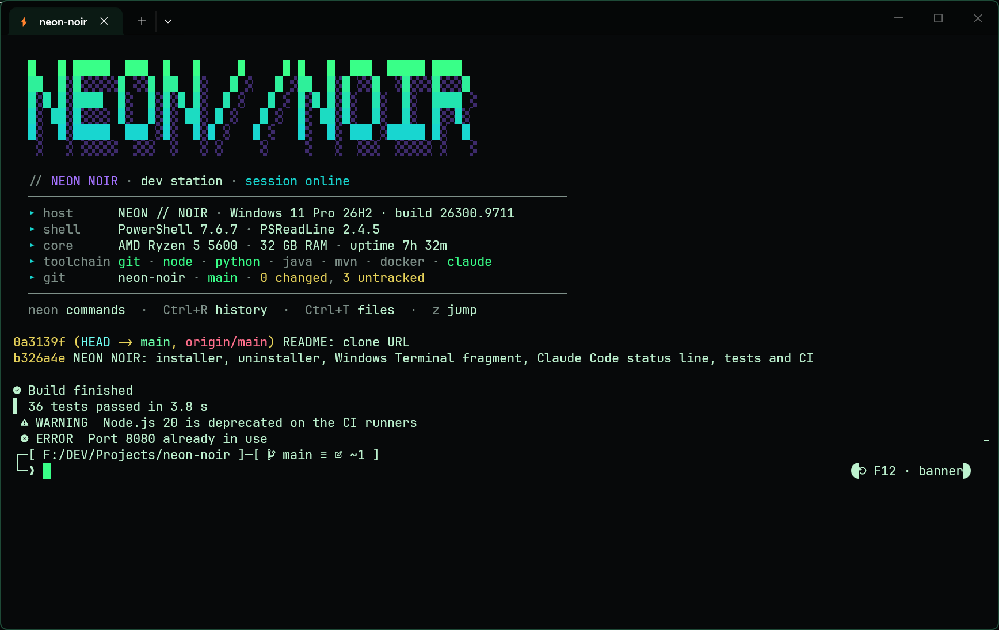
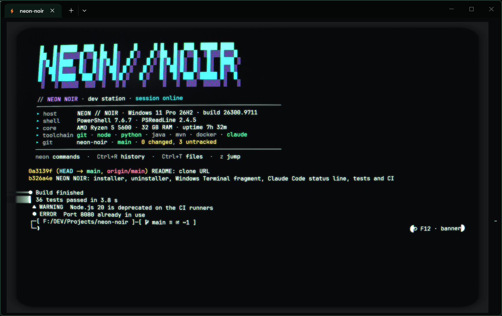
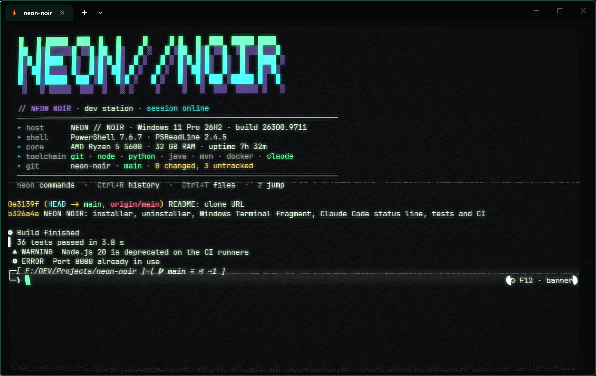
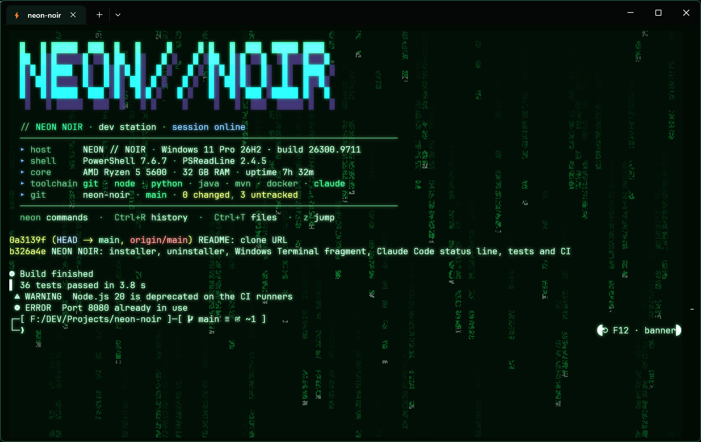
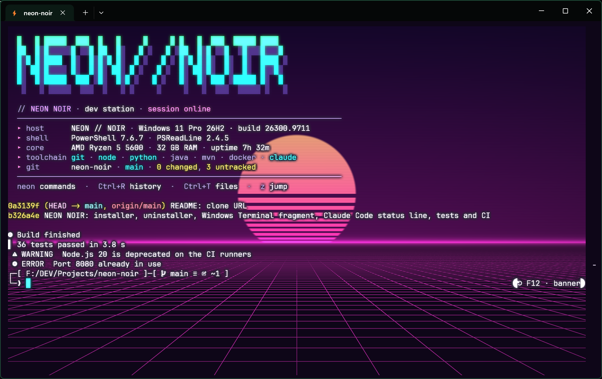
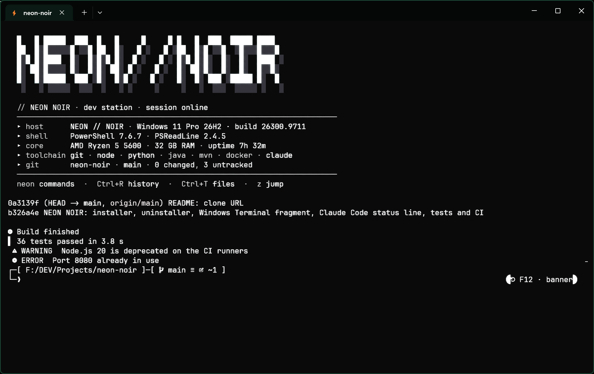
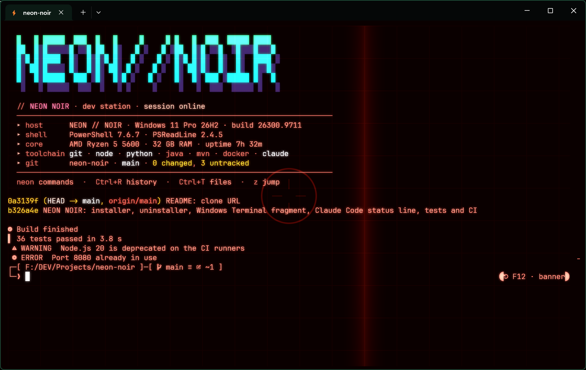

# NEON // NOIR

A cyberpunk setup for **Windows Terminal + PowerShell 7**: two-line prompt, start-up banner, per-directory history on ↑/↓, error and warning styling, long-command notifications, project shortcuts (`run`, `test`, `build`, `dirty`), 13 "cinema" modes made of shaders and colour schemes, plus a matching **Claude Code** status line.

Text stays readable in every mode: all effects spare the text and every theme uses a full 16-colour palette.



### Cinema modes

`cinema --mode` switches the whole terminal look with a live preview. A few of the 13 modes:

| | |
|---|---|
| **tv** · '80s television: RGB phosphor mask, rounded bezel, glass reflection<br> | **vhs** · videotape: bleeding color, head-switching noise, worn tape<br> |
| **matrix** · green phosphor, digital code rain falling behind the text<br> | **synthwave** · outrun: sunset sky, striped sun, magenta grid<br> |
| **noir** · '40s film noir: black & white, film scratches and dust<br> | **terminator** · T-800 vision: red HUD with grid, scan bar and crosshair<br> |

Also: `neon`, `amber`, `star-wars`, `hologram`, `blade-runner`, `tron`, `mr-robot`.

## Requirements

- Windows 10 1903+ or Windows 11, [Windows Terminal](https://aka.ms/terminal) 1.21+
- PowerShell 7 (the installer gets it with winget when started from Windows PowerShell 5.1)
- Optional: [Claude Code](https://claude.com/claude-code) and Node.js for the status line

## Install

```powershell
git clone https://github.com/gicerre/neon-noir.git
cd neon-noir
.\install.ps1                     # add -WhatIf to see every change first
```

| Option | Effect |
|---|---|
| `-Language it` | Italian texts (default `en`) |
| `-ProjectsRoot D:\code` | folder of the **Dev** tab and of `dirty` |
| `-SkipDependencies` | do not install anything with winget |
| `-NoTerminal` / `-NoClaude` | leave Windows Terminal / Claude Code alone |

Running `install.ps1` again updates an existing installation.

### What it changes

Nothing is replaced wholesale, and every file is backed up to `%LOCALAPPDATA%\neon\backup\<date>\` first.

| Where | Change |
|---|---|
| `Documents\PowerShell\neon\` | NEON scripts |
| PowerShell 7 profile | a 3-line block between `# >>> NEON NOIR >>>` markers; the rest is untouched |
| Windows Terminal `settings.json` | adds the *Neon Noir* scheme and theme, the **PowerShell 7 / Dev / Admin / Clean** profiles and `Neon.*` actions; sets only the keys listed in [`terminal/neon-noir.wt.json`](terminal/neon-noir.wt.json). Shortcuts already bound to something else are skipped and reported |
| `~/.claude/settings.json` | `statusLine`, only if you do not already have one |
| winget | PowerShell 7, Oh My Posh, zoxide, fzf, bat, ripgrep (user scope when possible) and JetBrainsMono Nerd Font |

Your preferences live in `~/.config/neon-noir/config.psd1` (only the keys you changed) and are never overwritten. `neon config` shows them.

## Use

| Command | |
|---|---|
| `neon` | command list |
| `cinema` · `Ctrl+Alt+C` | cinema mode on/off |
| `cinema --mode` | pick a mode with live preview |
| `neon title "TEXT"` | change the banner title |

## Uninstall

```powershell
.\uninstall.ps1                   # -Purge also deletes preferences, history and backups
```

It removes the profile block, the NEON items in Windows Terminal and the status line, and puts back the values that were there before installing — unless you changed them since. Programs installed with winget are kept; the uninstall commands are printed at the end.

## Development

```powershell
Install-Module Pester -MinimumVersion 5.5 -Scope CurrentUser
Invoke-Pester ./tests
```

Tests never touch real files: install and uninstall run end to end in a temporary folder.

| Folder | |
|---|---|
| `src/` | what gets installed (`neon-noir.ps1` is the entry point) |
| `terminal/` | Windows Terminal fragment merged into `settings.json` |
| `claude/` | Claude Code status line |
| `tools/NeonInstall.psm1` | merge / undo logic shared by the scripts and the tests |
