# Cinema themes

[← back to the README](../README.md)

Each theme is a pixel shader plus a matching colour scheme. `cinema` turns the default one (**neon**) on and off; `cinema --mode` opens a menu that previews every theme live while you move through it. Every theme is tuned to keep text readable: scanlines, grain, vignetting and flicker spare the characters, and animated backgrounds get a dark halo behind the text.

## neon
Neon CRT · phosphor glow and scanlines. The default.

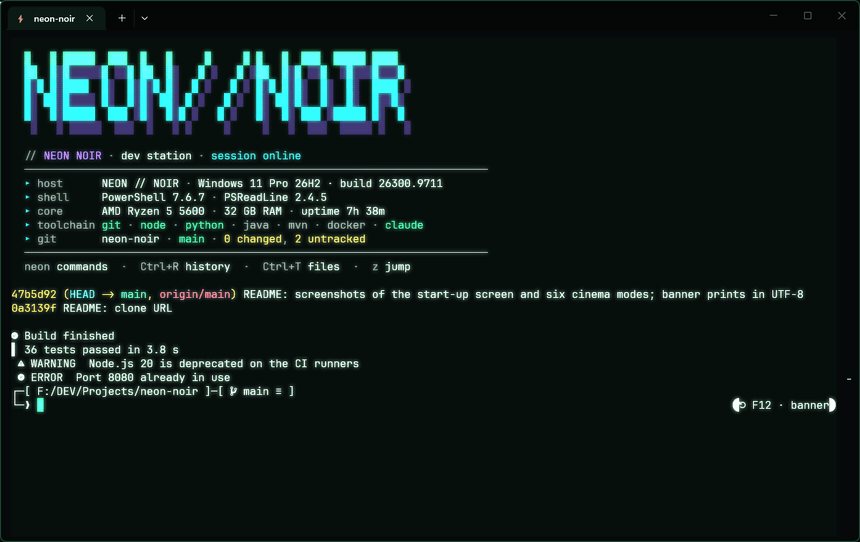

## tv
'80s television · RGB phosphor mask, rounded bezel, glass reflection.

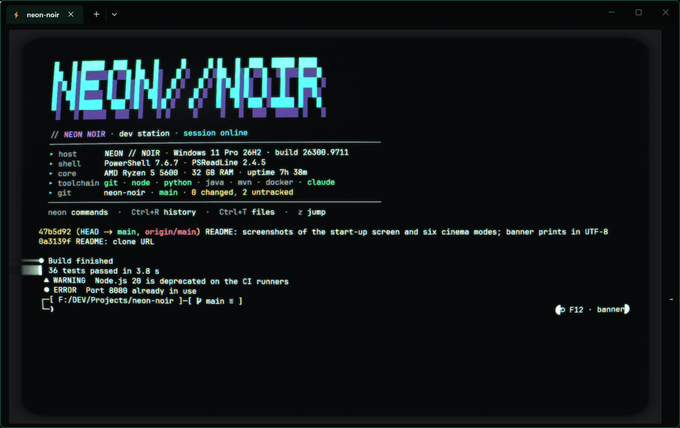

## matrix
Green phosphor · digital code rain falling behind the text.

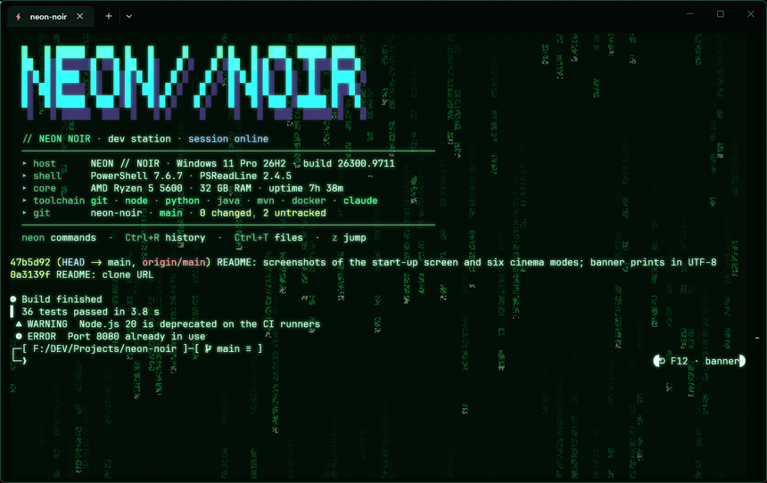

## amber
'80s amber terminal · phosphor persistence and a rolling sync bar.

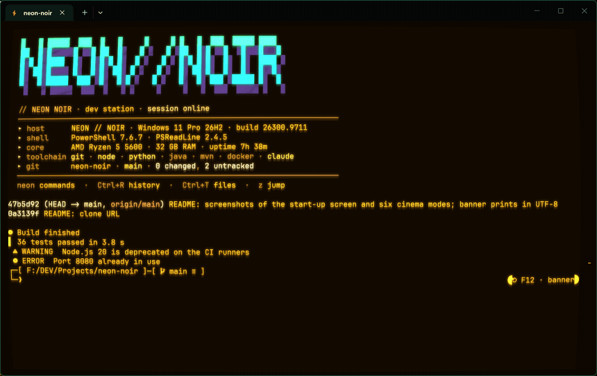

## star-wars
Opening crawl · older output tilts away into the stars, gold text, nebula. The lower half stays flat for the work you are doing.

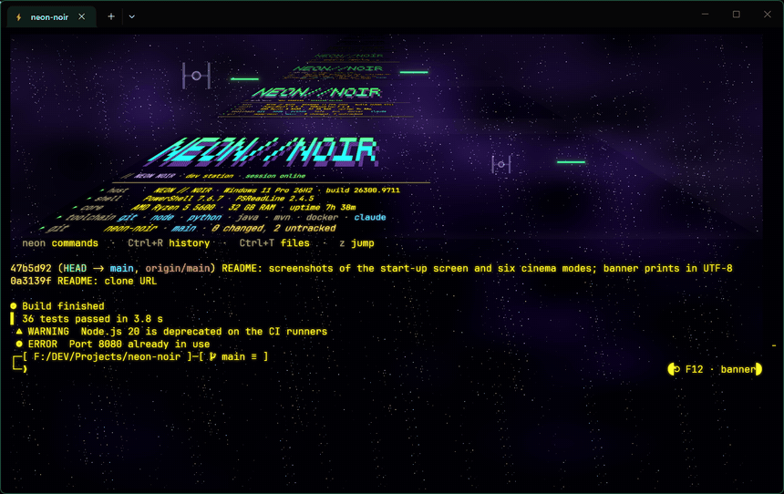

## hologram
Hologram · projector beam, glowing edges, sliced glitches, interlacing.

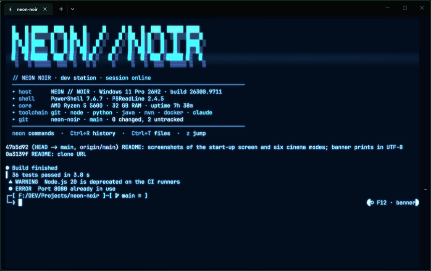

## blade-runner
Neo-noir · cinemascope bars, anamorphic flares, slanted rain, teal & orange.

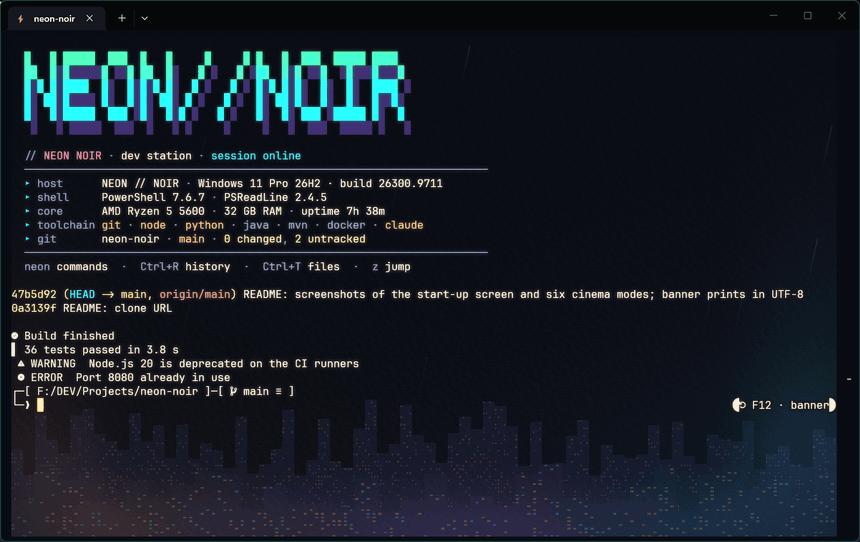

## tron
The Grid · scrolling neon floor in perspective, glowing text edges.

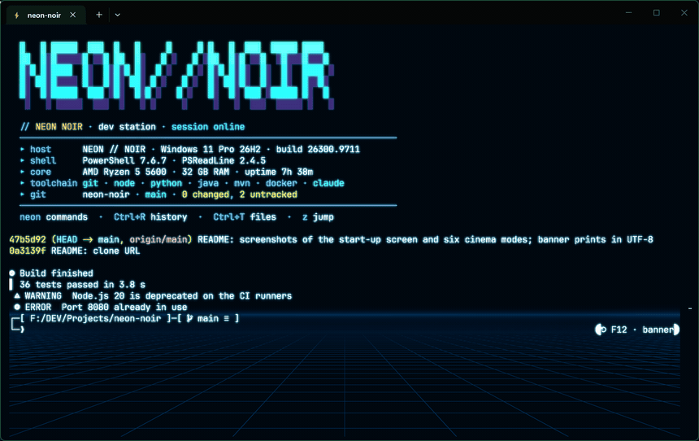

## vhs
Videotape · bleeding color, head-switching noise, worn tape.

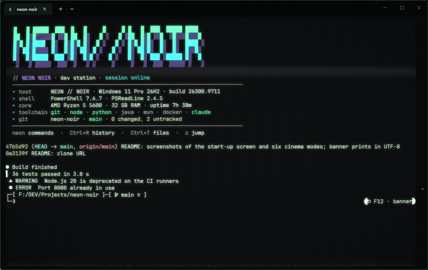

## mr-robot
fsociety · high-contrast black & white, only red survives, digital glitch blocks.

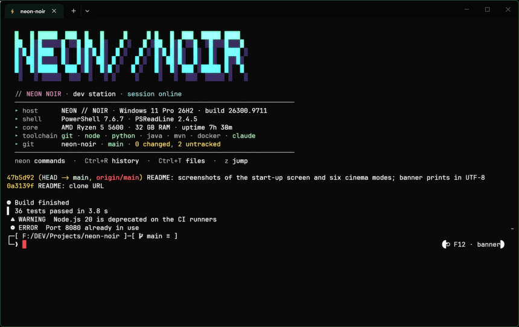

## synthwave
Outrun · sunset sky, striped sun, magenta grid, pink and cyan text.

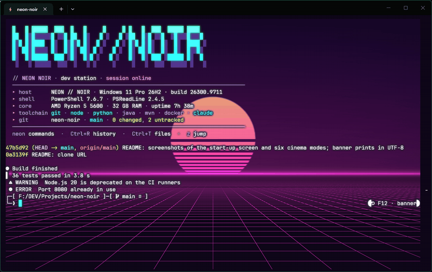

## noir
'40s film noir · black & white, film scratches and dust, flickering exposure.

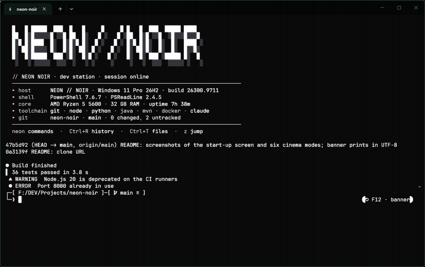

## terminator
T-800 vision · red HUD with grid, scan bar and crosshair.

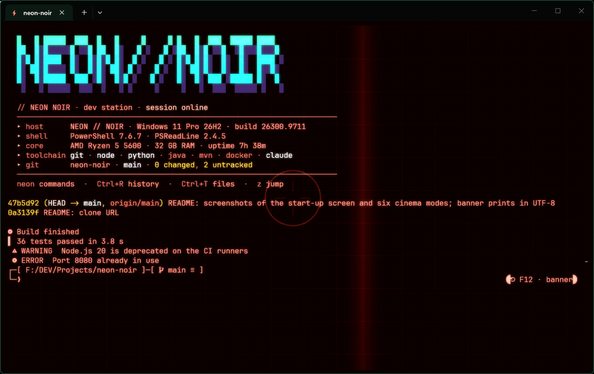

